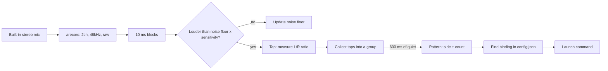
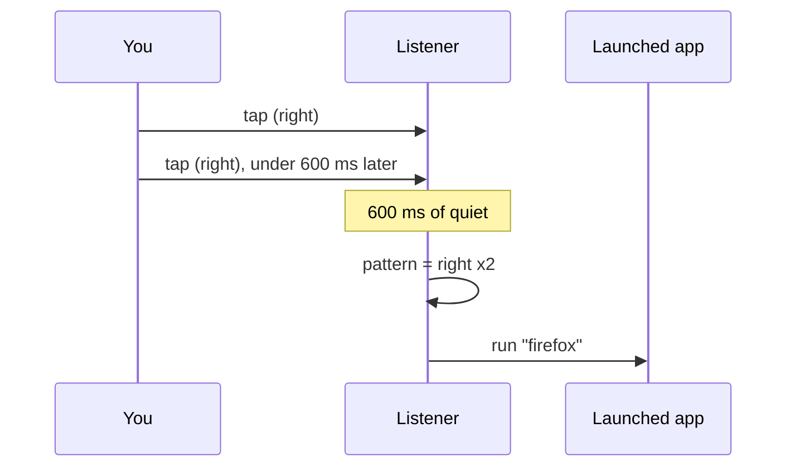

# playS — Tap to Launch

Knock on your laptop to launch apps. **Where** you tap (left or right side) and **how many times** you tap decides which command runs.

| Pattern        | Example action          |
|----------------|-------------------------|
| Right side x2  | open `firefox`          |
| Left side x2   | open `gnome-terminal`   |
| Right side x3  | open `code`             |
| Left side x3   | any shell command       |

It uses the laptop's built-in stereo microphone, so there's no extra hardware. Everything runs on the Python standard library plus `arecord`.

---

## Requirements

- Linux with ALSA (`arecord`, part of `alsa-utils`, is preinstalled on most distros)
- Python 3.8+
- Tkinter for the window: `sudo apt install python3-tk`
- A laptop with a 2-channel (stereo) microphone array. Check with:

```bash
arecord -l                                       # look for a "DMIC" device
arecord -D hw:0,6 --dump-hw-params -d 1 /dev/null 2>&1 | grep CHANNELS
```

## Quick start

```bash
git clone https://github.com/Mahin-Abrar/playS.git
cd playS
sudo apt install python3-tk
python3 tapper.py
```

The window opens and starts listening right away.

1. Press **Calibrate**, then tap the **left** side 5 times slowly, then the **right** side 5 times.
2. Press **Add** to bind a pattern: choose a side, a tap count, and the command to run.
3. Tap away.

No window? Run it in the terminal instead:

```bash
python3 tapper.py --headless
```

```text
Listening... Ctrl+C to quit
  tap  L/R=+0.412
  tap  L/R=+0.388
left x2 -> gnome-terminal
```

---

## The window

```text
┌─ Tapper ──────────────────────────────────────────────────┐
│ Side   Taps  Command                                      │
│ ───────────────────────────────────────────────────────── │
│ right  2     firefox                                      │
│ left   2     gnome-terminal                               │
│ right  3     code                                         │
│                                                           │
│ [Add] [Edit] [Delete] [Stop] [Calibrate]                  │
│                                                           │
│ Sensitivity (higher = needs louder tap)  ──●──────── 6.0  │
│                                                           │
│ right x2  ->  firefox                                     │
└───────────────────────────────────────────────────────────┘
```

| Control      | What it does                                                        |
|--------------|---------------------------------------------------------------------|
| Add / Edit   | Create or change a binding (side, tap count 1-9, shell command)     |
| Delete       | Remove the selected binding                                         |
| Start / Stop | Turn listening on or off                                            |
| Calibrate    | Learn what a left tap and a right tap sound like on *your* laptop   |
| Sensitivity  | How much louder than background noise a tap must be                 |
| Status line  | Shows each tap's L/R reading and every pattern detected or launched |

---

## How it works



### 1. Listening

`tapper.py` starts `arecord` and reads raw 16-bit stereo audio in 10 ms chunks. For each chunk it computes the loudness (RMS) of the left and right channels separately.

### 2. Detecting a tap

The script keeps a running estimate of the background noise (the *noise floor*). A chunk counts as a tap when it is louder than `noise floor x sensitivity`.

```text
loudness
   ▲
   │        █               █
   │        █               █           ← taps (spikes)
   │ - - - -█- - - - - - - -█- - - - -  ← noise floor x sensitivity
   │▁▂▁▂▁▁▂▁█▃▂▁▂▁▁▂▁▂▁▂▁▁▂▁█▃▂▁▂▁▁▂▁▂
   └──────────────────────────────────────► time
            │◄─ 80 ms ignored (echo of the same knock)
```

- The first 0.5 s are used only to learn the noise level.
- For 80 ms after each tap, new spikes are ignored, so the ringing of one knock isn't counted twice.
- The noise floor adapts slowly, so steady noise like a fan or music stops triggering taps after a moment.

### 3. Telling left from right

A tap on the left reaches the left microphone a little louder than the right one, and the reverse for a tap on the right. For every tap the script computes

```text
L/R value = log(left loudness / right loudness)
```

Calibration records the average L/R value for left taps and for right taps. A new tap is classified by which side of the midpoint it falls on:

```text
       right taps          midpoint          left taps
  ◄───────●●●●───────────────┼───────────────●●●●───────►  L/R value
        -0.40                0.00            +0.40
```

If taps in one group disagree, the majority wins.

### 4. Counting taps

Taps belong to the same group until there are 600 ms of quiet. Then the group becomes a pattern such as `right x2`.



### 5. Launching

The matching command runs through the shell in its own session, so the app keeps running even if you close Tapper. Any shell command works: `firefox`, `code ~/projects`, `xdg-open https://github.com`, `notify-send hi`, or a script of your own.

---

## Configuration

Settings are saved to `config.json` next to the script. The window edits it for you, but you can also edit it by hand:

```json
{
  "device": "plughw:0,6",
  "sensitivity": 6.0,
  "calibration": { "left": 0.4, "right": -0.4 },
  "bindings": [
    { "side": "right", "taps": 2, "command": "firefox" },
    { "side": "left",  "taps": 2, "command": "gnome-terminal" }
  ]
}
```

| Key           | Meaning                                                              |
|---------------|----------------------------------------------------------------------|
| `device`      | ALSA capture device. Find yours with `arecord -l` (card,device).     |
| `sensitivity` | Tap threshold as a multiple of background noise. 4-10 is typical.    |
| `calibration` | Average L/R value for each side. Set by the Calibrate button.        |
| `bindings`    | List of `side` (`left`/`right`) + `taps` (count) + `command`.        |

Timing constants (block size, 80 ms echo window, 600 ms group end, warm-up) are at the top of `tapper.py`.

---

## Start at login (optional)

```bash
mkdir -p ~/.config/autostart
cat > ~/.config/autostart/tapper.desktop <<EOF
[Desktop Entry]
Type=Application
Name=Tapper
Exec=python3 $PWD/tapper.py --headless
EOF
```

---

## Troubleshooting

| Problem                            | Fix                                                                       |
|------------------------------------|---------------------------------------------------------------------------|
| `No module named 'tkinter'`        | `sudo apt install python3-tk`, or use `--headless`                        |
| Taps not detected                  | Lower the sensitivity, or tap firmer near the edges of the palm rest      |
| Typing or noise triggers commands  | Raise the sensitivity; prefer 2+ tap bindings over single taps            |
| Left and right get mixed up        | Re-run Calibrate; tap the same spots each time                            |
| Left and right readings look alike | The built-in mics are very close together; try tapping harder or use a USB stereo mic placed wider apart |
| `audio stream ended` / device error | Set `device` in `config.json` to a device listed by `arecord -l`         |

**Known quirk:** if you bind a 5-tap pattern, the last 5 calibration taps can trigger it once calibration ends.
